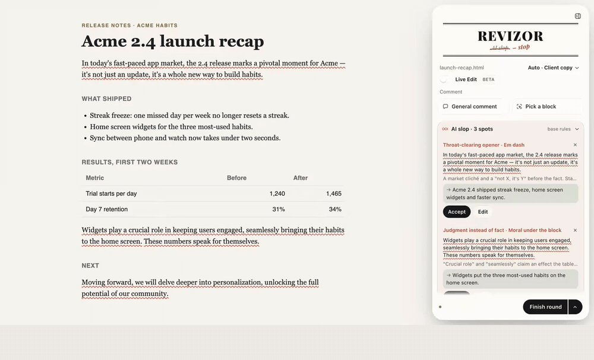

# Revizor – edit AI-written documents in the browser, then let Claude Code apply your edits

[](https://github.com/qttc/revizor/actions/workflows/test.yml)
[](https://github.com/qttc/revizor/releases)
[](LICENSE)

English · [Русский](README.ru.md) · Site: [tratseuski.com/revizor](https://tratseuski.com/revizor/)

Revizor is a local review editor for [Claude Code](https://claude.com/claude-code). You open a report, a deck or a Markdown file the agent wrote, rewrite the parts you don't like right on the page, and the agent applies your edits to the source file. It also flags AI slop in the text and learns your writing style from the edits you make.

<picture>
  <source media="(prefers-color-scheme: dark)" srcset="docs/demo-dark.gif">
  
</picture>

The document in the demo is [examples/launch-recap.html](examples/launch-recap.html). To try it, ask Claude Code to open that file in Revizor.

## Why

Fixing an AI draft through chat is slow. You quote a paragraph, explain where the change goes, and check whether the agent changed the right sentence. In Revizor you edit the page as the reader will see it. Every edit is stored with its exact place in the document, so the agent applies it in the right spot without guessing.

## How it works

1. In Claude Code, type `/revizor` or "open it in the editor". Chrome opens with the document on the left and the Revizor panel on the right.
2. Make your edits:
   - select a phrase → **Edit** and type your version;
   - select a phrase → **Comment** to ask for a change in that spot;
   - **Pick a block** to comment on a paragraph, chart, image or table;
   - **General comment** for the whole document, for example "shorter headings".
3. Click **Finish round**. The agent applies the edits, tells you what it changed and what it skipped, and reloads the new version in the same tab for another pass. When it is the last pass, open the arrow next to the button and pick **Finish the work**: the agent applies the edits, wraps up in the chat and does not reopen the document.

Edits are saved as you go to `report.review.json` next to the document. If you close the tab before you finish, tell the agent "apply the edits" and it picks them up from that file.

**Live Edit (beta).** Turn it on in the panel header and every edit gets a **Send to agent** button. The agent applies that one edit, and the page updates without a reload.

## AI slop check

Before the owner sees a draft, `revizor.py check` hands the text to an independent reader: a separate `claude -p` run that sees only the text and the catalog of tells, without the author's context. An author checking their own draft misses about half of the tells because they remember what they meant. For HTML the same command opens the page in headless Chrome at 1440 and 390 px and reports misaligned table headers, blocks running off the edge, empty slides, conclusions hidden in collapsed blocks and broken images, with a screenshot.

When a document opens, Revizor underlines phrases that give away a language model. On English text that means em dashes and Claude phrasing such as "less like X, more like Y", "matters because" or "without sacrificing". Russian text gets a longer rule set. The panel groups the hits by sentence: **Fix** corrects mechanical issues on the spot, **Rewrite** turns the sentence into an edit, **To agent** sends it to the agent. Mark a false positive with ✕ and it won't show again.

While you read, the agent goes through the text for patterns a regex can't catch: a moral line under each paragraph, "it's not X, it's Y" contrasts, "-ing" tails that add nothing. Its findings show up in the same panel with a suggested rewrite you can accept or adjust.

The rules and the catalog of patterns come from your own style skill in Claude Code if you have one; Revizor finds it on its own and picks the catalog by the document language.

## Learns your writing style

Every "before → after" edit teaches the skill the agent writes with. An edit that matches a known pattern confirms it. A new pattern becomes a rule after it shows up three times in different documents. A word you keep replacing turns into an automatic check, and a check you keep dismissing gets narrowed or switched off.

Learning runs after a review once 5 new edits have piled up. If you don't have a style skill, Revizor creates one in `~/.claude/skills/writing-style`. Product names and numbers from your documents stay out of the skill; only the shape of the edit goes in.

## Learns how you build documents

Comments on a passage, a block or the whole document pile up in a documents playbook next to the style skill. "Conclusions come too early", "every chart needs a one-line takeaway", "no jargon here" – once you keep writing the same thing on different documents, it becomes a rule, and the agent builds the next document by it. Learning runs after a review once 5 resolved comments have piled up.

## Supported formats

- HTML: reports, decks, slides in iframes, self-unpacking exports.
- Markdown, shown rendered or as source.
- Plain text.
- A page on your local dev server, such as a landing page built with Astro, Next or Vite: ask Claude to open `http://localhost:4321/` in Revizor. Revizor sits between the tab and the dev server, adds its panel to every page and passes everything else through, hot reload included. Claude applies the edits in the project's source files, and the dev server reloads the page. Only local addresses open, and the review file stays in Revizor's cache, so nothing is added to the project.

## Install

You need macOS or Linux, Python 3.9+, Chrome and Claude Code. Nothing else to install.

As a Claude Code plugin, inside Claude Code:

```
/plugin marketplace add qttc/revizor
/plugin install revizor@revizor
```

Or from a clone:

```
git clone https://github.com/qttc/revizor.git
revizor/install.sh
```

`install.sh` links the `/revizor` skill into `~/.claude/skills`. Use one install method: with both, Claude Code sees two copies of the skill that can be on different versions. Or paste this prompt into Claude Code, in the app or in the terminal, and Claude sets everything up:

```
Install Revizor, a review editor for Claude Code: https://github.com/qttc/revizor

1. Check that python3 3.9 or newer and Google Chrome are installed. If something is missing, tell me and stop.
2. Clone the repo into ~/revizor. If the folder exists and is a clone of the same repo, run git pull.
3. Run ~/revizor/install.sh. It links the /revizor skill.
4. Test it: create test.md in a temp folder and open it with the revizor skill.
5. Tell me in one line what was installed and how to use it: "/revizor <file>" or "open it in the editor".
```

`npx skills add qttc/revizor` copies only the skill folder, without `revizor.py`, so Revizor can't run from it. Use the plugin or a clone.

If `/revizor` doesn't show up in the command list, start a new session: skills load when a session starts.

## Update and uninstall

When a new release is out, the agent offers to update the next time you run `/revizor`. To update by hand, tell the agent "update revizor" or run `python3 revizor.py update`.

`revizor/install.sh --uninstall` removes the skill and lists what is left on disk: the clone, the cache and the review files next to your documents.

## Privacy

Documents and edits stay on your machine. The editor server listens on `127.0.0.1` only and accepts requests from its own tab. Once a day Revizor runs `git ls-remote` against this repo to check for a new release; `REVIZOR_NO_UPDATE_CHECK=1` turns that off. See [SECURITY.md](SECURITY.md).

What Revizor runs and writes:

- `python3 revizor.py`, Python standard library only. It starts a local HTTP server on `127.0.0.1` that serves the document's folder, without hidden files and review files.
- Chrome, or the default browser on Linux, to open the editor page.
- `git ls-remote` once a day to check for a release, and `git fetch` with a fast-forward to the latest release tag when you update a clone.
- Files it writes: `<document>.review.json` next to the document, `~/.cache/revizor/` (ports, open documents, text for the slop check, update check), and your writing skill in `~/.claude/skills/writing-style/` when learning runs. It reads `~/.config/revizor/config.json` if it exists.
- Nothing is sent anywhere else. Fonts and the Motion library ship in `web/vendor`, so the editor page loads nothing from the network.

## FAQ

**Does it work without Claude Code?** The editor and the review file work on their own: `python3 revizor.py open report.md` opens the page, and `revizor.py show report.md` prints the edits. Applying edits and the slop check by meaning need an agent that follows `skill/SKILL.md`.

**Is the interface in English?** Yes. It follows your browser language. Set `"ui_lang": "en"` or `"ru"` in `~/.config/revizor/config.json` to pin it.

**Can other tools read the edits?** Yes. The review file format is stable from 1.0.0 and has a [JSON Schema](docs/review.schema.json). Commands, the file format and internals are described in [docs/technical.md](docs/technical.md) (in Russian).

## License

[MIT](LICENSE)
