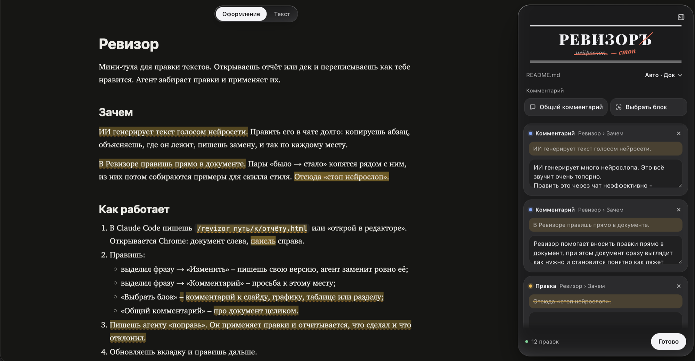

# Ревизор – правь тексты ИИ прямо в браузере, Claude Code применит правки

[English](README.md) · Русский

Мини-тула для правки текстов. Открываешь отчёт или дек и переписываешь как тебе нравится. Агент забирает правки и применяет их.



## Зачем

ИИ генерирует много нейрослопа. Править это через чат неэффективно: постоянно приходится ссылаться на абзацы и маркеры, объяснять, где нужно сделать замену.

В Ревизоре правишь прямо в документе. Он выглядит так, как его увидит читатель, и сразу видно, где будет правка. Пары «было → стало» находятся рядом с документом, из них потом собираются примеры для скилла стиля.

## Как работает

1. В Claude Code пишешь `/revizor` или «открой в редакторе». Открывается Chrome: документ слева, Ревизор справа. Путь к файлу нужен, только если агент не знает, какой документ открыть.
2. Вносишь изменения:
   - выделил фразу → «Изменить» – помечаешь правки для ИИ;
   - выделил фразу → «Комментарий» – просьба к этому месту;
   - «Выбрать блок» → комментарий к абзацу текста, графику, картинке, таблице;
   - «Общий комментарий» → про весь документ, например «замени стиль» или «поправь заголовки».
3. Жмёшь «Завершить ревью». Агент применяет правки, отчитывается, что сделал и что отклонил, и открывает новую версию в той же вкладке. Можно сразу на второй круг.

Правки сохраняются сами в `отчёт.review.json` рядом с документом. Закрыл вкладку без «Завершить ревью» – напиши агенту «поправь», он заберёт их из файла. Формат текста (отчёт, дек, Slack, спека, письмо) Ревизор определяет сам, поменять можно в шапке.

**Live Edit (бета).** Режим включается в шапке панели. У каждой правки появляется кнопка «Отправить агенту»: агент применяет правку сразу, и документ на странице обновляется сам.

## Проверка на нейрослоп

Документ открылся – Ревизор сразу подчёркивает красной волной обороты, по которым видно нейросеть: «не про X», «X, не Y», длинное тире, филлеры, «Однако,» с запятой. В панели они собраны по предложениям. «Исправить» правит механику сразу, «Переписать» даёт предложение в правку, «Агенту» просит переписать его. Крестик – «это не нейрослоп», больше это место не покажется.

Пока ты читаешь, агент проходит текст по смыслу: мораль под абзацем, «дело не в X, дело в Y», «подход позволяет…, обеспечивая…». Такие места появляются в той же группе с готовым вариантом – «Принять» или «Поправить».

Правила и каталог примет берутся из твоего скилла стиля, если он есть в Claude Code: Ревизор находит его сам.

Английские тексты проверяются по английскому каталогу. Язык Ревизор определяет по тексту документа, а скилл под каждый язык может быть свой.

## Скилл стиля учится на правках

Каждая правка «было → стало» учит скилл, по которому агент пишет тексты. Повтор приёма, который уже знаком, только подтверждает его, новый приём сначала копится кандидатом и становится правилом после трёх случаев в разных документах. Слово, которое ты раз за разом меняешь, превращается в правило проверки. Если проверка ошибается и ты её отклоняешь, правило сужается или выключается.

Обучение запускается само после ревью, когда накопилось 5 новых правок. Если скилла стиля у тебя нет, Ревизор создаст его сам в `~/.claude/skills/writing-style`, и дальше агент будет писать по нему все тексты для людей. Рабочие названия и цифры в скилл не попадают, только форма правки.

## Поддерживаемые форматы

- HTML – отчёты, деки, слайды во фреймах, самораспаковывающиеся экспорты.
- Markdown – «Оформление», как увидит читатель, или «Текст» с разметкой.
- TXT.

## Установка

```
git clone https://github.com/qttc/revizor.git
revizor/install.sh
```

Нужны macOS или Linux, Python 3.9+, Chrome и Claude Code, остальное лежит в репо. `install.sh` подключает скилл `/revizor`.

Или вставь в Claude Code этот промпт, в приложении или в терминале, и Claude поставит всё сам:

```
Установи мне Ревизор – редактор правок для Claude Code: https://github.com/qttc/revizor

1. Проверь, что есть python3 версии 3.9 или новее и Google Chrome. Чего-то нет – скажи и остановись.
2. Склонируй репо в ~/revizor. Папка уже есть и это клон того же репо – сделай git pull.
3. Запусти ~/revizor/install.sh. Он подключит скилл /revizor.
4. Проверь: создай тестовый test.md во временной папке и открой его по скиллу revizor.
5. Отчитайся одной строкой, что установлено, и скажи, как мной пользоваться: «/revizor <путь к файлу>» или «открой в редакторе».
```

`/revizor` не появился в списке команд – открой новую сессию: скиллы подхватываются при её старте.

## Удаление

`revizor/install.sh --uninstall` снимает скилл и перечисляет, что осталось на диске: клон, кэш, файлы правок рядом с документами.

## Обновление

Вышла новая версия – агент предложит обновиться при запуске `/revizor`. Вручную – написать агенту «обнови ревизор» или `python3 revizor.py update`.

Документ и правки с компьютера не уходят. В сеть Ревизор ходит раз в сутки проверить версию, выключается `REVIZOR_NO_UPDATE_CHECK=1`.

Интерфейс – на языке браузера, закрепить можно `"ui_lang": "ru"` или `"en"` в `~/.config/revizor/config.json`.

Команды, формат файла правок и устройство – в [docs/technical.md](docs/technical.md), схема формата – [docs/review.schema.json](docs/review.schema.json). Безопасность – [SECURITY.md](SECURITY.md).
